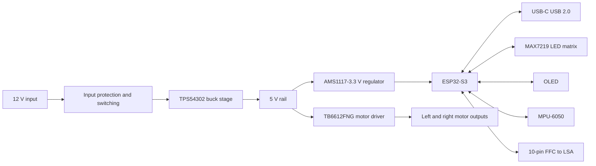

# Wall-E SRA Board · 2026–27

**A KiCad hardware platform for the Society of Robotics and Automation (SRA), VJTI.**

The SRA board brings the control, sensing, display, power, and motor interfaces for a small mobile robot onto one development board. This repository contains the main SRA board design, its companion Line Sensor Array (LSA), local KiCad libraries, 3D models, and fabrication exports.

---

## At a glance

| Area | Design |
| --- | --- |
| Main controller | ESP32-S3-WROOM-1 module |
| Input and power | 12 V input, TPS54302 step-down stage, 5 V rail, AMS1117-3.3 V regulator |
| Motor control | TB6612FNG dual H-bridge and two motor outputs |
| Robot sensing | 10-pin FFC connection for the LSA; MPU-6050 connection |
| User interface | OLED connection, MAX7219-driven 8×8 LED matrix, buttons and status signals |
| Host connection | USB-C USB 2.0 interface for development and programming |
| Design tools | KiCad schematic, PCB, project and local symbol/footprint libraries |

> **Design status:** This repository contains design files and exported fabrication data. Their presence does not by itself confirm electrical validation, manufacturing quality, or tested board behavior. Check the current schematic, PCB, and fabrication outputs before ordering or assembling hardware.

## System overview

The power design separates the motor supply from the regulated logic rails. The schematic shows a TPS54302 switching regulator for the 5 V rail and an AMS1117-3.3 for 3.3 V logic. Resettable PTC fuses are used in the design; the schematic lists 3 A and 1 A parts. These values describe the selected components, not a verified continuous-current rating for a completed board.

The main controller connects to the motor driver and the board peripherals. The TB6612FNG provides two H-bridge channels for two DC motor outputs. The MAX7219 handles the LED matrix interface, reducing the number of controller signals needed for the display. The OLED and MPU-6050 connect as board peripherals, and the companion LSA connects over the 10-pin FFC interface.

## Board features

### SRA controller board

- **ESP32-S3 control:** Wi-Fi/Bluetooth-capable MCU module and GPIO-based control for the robot and its peripherals.
- **USB-C interface:** USB 2.0 data connection to the controller for development and programming.
- **12 V power path:** board input with switching and protection circuitry, followed by regulated 5 V and 3.3 V rails.
- **Dual motor driver:** TB6612FNG H-bridge with separate control signals and two motor connectors.
- **Line sensing:** 10-position, 1.0 mm pitch FFC connector to the companion LSA board.
- **Motion sensing:** connection for an MPU-6050 inertial measurement module.
- **Display and feedback:** OLED connection and an 8×8 LED matrix driven by a MAX7219.
- **Controls:** reset/boot buttons and board-level power control signals.

### Line Sensor Array (LSA)

The `lsa/` directory contains a separate KiCad project for the line sensor board. It connects to the SRA board through a 10-pin FFC cable. Its schematic includes five analog sensor outputs labelled `LSA_A0` through `LSA_A4`; use the schematic and board pin labels as the wiring reference when integrating it.

## Repository map

| Path | Contents |
| --- | --- |
| `sra_board.kicad_pro` | Main SRA KiCad project settings |
| `sra_board.kicad_sch` | Main board schematic |
| `sra_board.kicad_pcb` | Main board PCB layout |
| `sra_board.step` | 3D STEP export of the main board assembly |
| `lsa/lsa.kicad_pro` | LSA KiCad project settings |
| `lsa/lsa.kicad_sch` | LSA schematic |
| `lsa/lsa.kicad_pcb` | LSA PCB layout |
| `3D/` | Component STEP models used by the designs |
| `MAX7219/` | MAX7219 symbol, footprints, and supporting files |
| `footprints.pretty/` | Project-specific KiCad footprints |
| `fp-lib-table`, `sym-lib-table` | Project-local footprint and symbol library tables |
| `sra-board-final-iteration-2027/` | Gerber, drill, and job files for the SRA board |
| `lsa/LSA-Wall-E-2027/` | Gerber, drill, and job files for the LSA board |
| `assets/` | Reference board images from an earlier board snapshot; compare with the current PCB before relying on them |

## Open and work with the designs

1. Install KiCad and clone this repository with Git, or download the repository as a ZIP archive.
2. Open `sra_board.kicad_pro` in KiCad to work on the SRA board. Open `lsa/lsa.kicad_pro` for the LSA.
3. Keep the project files, library tables, local footprints, symbols, and 3D models together so KiCad can resolve the project-specific references.
4. Make schematic changes first, then update the PCB from the schematic in KiCad and review footprints, net assignments, clearances, and board geometry.
5. Re-export fabrication files from the reviewed PCB if it has changed. The checked-in Gerbers are snapshots and may not match later edits.

### Fabrication files

The two export directories contain copper, solder-mask, solder-paste, silkscreen, outline, drill, and Gerber job files. Use the matching directory for the board being fabricated. Before sending files to a manufacturer, confirm that the exports correspond to the intended revision and inspect the layer set, board outline, drill map, and fabrication notes in a Gerber viewer.

The `.step` files are for mechanical and enclosure review. They are not substitutes for the KiCad source files or fabrication exports.

## Power and battery notes

The board is designed around a 12 V input for the motor and board power path. If using a three-cell lithium-ion battery pack, use a correctly rated external 3S battery-management system (BMS) and charger. The BMS is not the board’s battery charger. Confirm the voltage range, polarity, connector pinout, fuse suitability, motor current, regulator thermal limits, and wiring before powering a completed assembly.

## Project context and contributors

The SRA board is used in SRA VJTI robotics work, including the [Wall-E](https://github.com/SRA-VJTI/Wall-E) and [MARIO](https://github.com/SRA-VJTI/MARIO) projects. The board is designed in KiCad.

- [Varun Patil](https://github.com/VarunAPatil) — Designer
- [Omkar Nanajkar](https://github.com/nomkar24) — Designer

## License

There is no `LICENSE` file in this repository at present. Check with the project maintainers before reusing or redistributing the hardware design.
